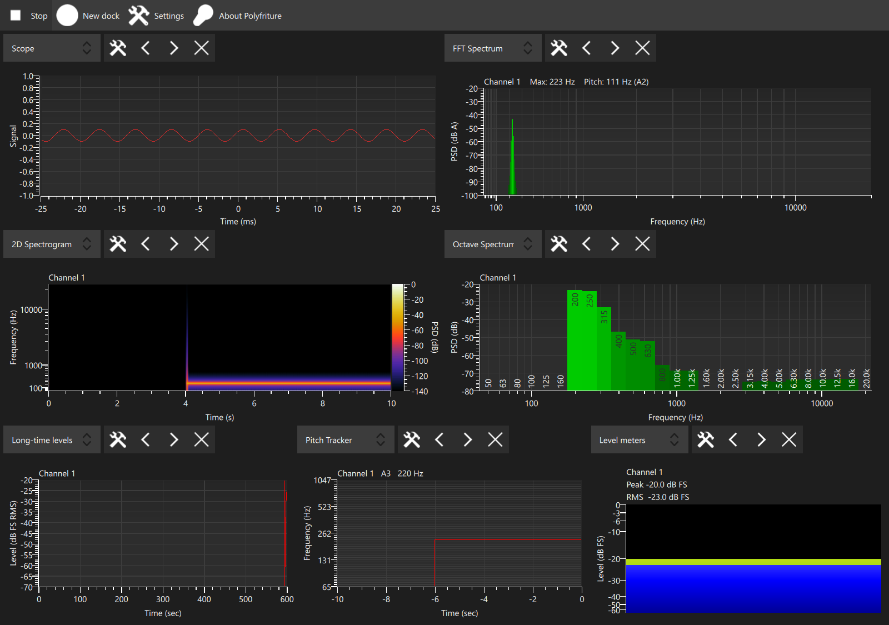
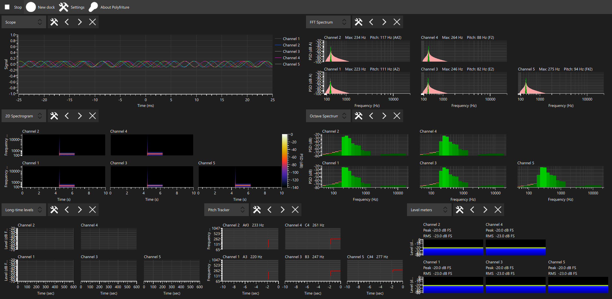
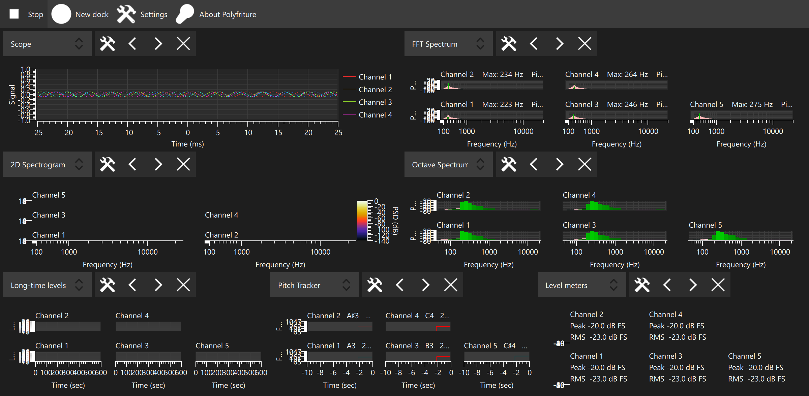
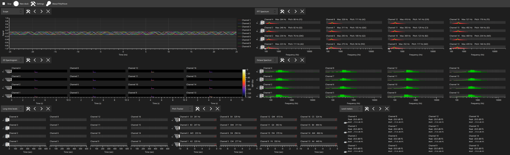
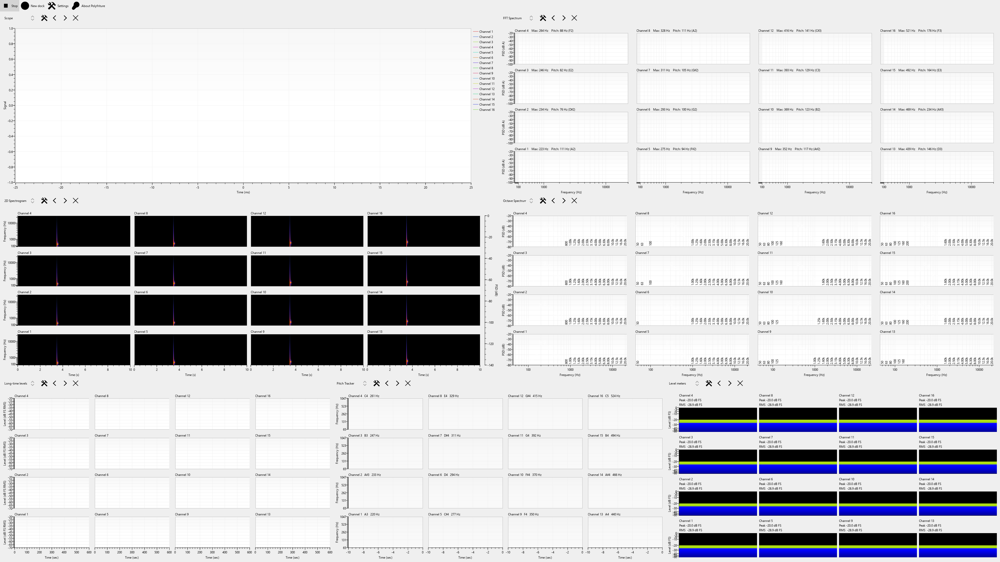

Multichannel integration and release verification
=================================================

This report records the final integration pass for the multichannel roadmap
(`issue 16 <https://github.com/WillHirsch/polyfriture/issues/16>`_).
The configurations below are observations on one machine, rather than supported
limits. Polyfriture does not cap selected channels or plot sizes, change analysis
parameters automatically, or promise real-time processing for every layout.

Reproduce the measurements
--------------------------

From the repository root::

    uv sync --frozen --dev
    uv run --frozen python scripts/verify_multichannel.py --help
    uv run --frozen python scripts/verify_multichannel.py --duration 5 --warmup 1 --output tools/verification

That default command uses headless Qt. The recorded native Windows run used::

    uv run --frozen python scripts/verify_multichannel.py --duration 5 --warmup 1 --timeout 90 --platform windows --visible --output tools/verified-measurements
    uv run --frozen python scripts/verify_multichannel.py --case full-4k:16:4:3840x2160:1:normal --duration 5 --warmup 1 --timeout 90 --renderer software --output tools/verified-4k

``--visible`` displays a synthetic test window without taking keyboard focus.
Use the native Qt platform appropriate to the machine, such as ``windows``,
``cocoa`` or ``xcb``, when checking the normal graphics renderer. The default
offscreen software renderer does not draw the custom scene-graph curves/bars
on this Windows host; it can verify geometry and spectrogram images. Native
Direct3D screenshots below additionally verify that the traces are rendered.

The harness starts a fresh process for each case. It uses temporary INI profiles,
never discovers Friture settings, never opens audio hardware, and renders all
seven input visualizations through the real application, backend, audio buffer
and dock connections. Generator is exercised separately by the lifecycle test;
the measurement harness does not generate physical audio output.

The synthetic source advances at 48 kHz according to wall time, including while
the GUI is busy. Its ring has the production capacity, 131,072 frames. Overflow
figures describe this synthetic queue, not PortAudio or a physical device.
Process CPU includes synthetic tone generation and Qt rendering. CPU percentage
uses one logical core as 100%; it is not divided by the machine's core count.
Resident memory is sampled from the operating system, and the reported process
peak includes startup. A 50 ms Qt timer measures event-loop responsiveness.
The stop timer may run late under load, so actual measurement duration is also
recorded. A parent-process watchdog records a failure instead of accepting a
stalled child.

The built-in cases exercise incomplete grids, rotation, multiple window sizes,
display scale factors and a larger configuration. Custom cases use
``NAME:CHANNELS:COLUMNS:WIDTHxHEIGHT:SCALE:normal|rotated``. These cases are
samples for investigation, not a maximum or a pass/fail performance threshold.

Measured results
----------------

Recorded on 23 October 2026 with all seven input panels and their default
analysis parameters. Machine: Intel Core Ultra 7 155U, 12 cores / 14 logical
processors, 15.45 GiB RAM, Intel Graphics, Windows build 26300, Python 3.11.1,
NumPy 2.4.6, PyQt 6.11.0, Qt runtime 6.11.1, Segoe UI 9 pt. Native cases use
Direct3D11 and Qt's default render loop; the full-size headless case uses
software rendering. The host's native scale is 125%, multiplied by each case's
``QT_SCALE_FACTOR``.

.. list-table:: Actual geometry (not just requested window sizes)
   :header-rows: 1

   * - Case
     - Channels / columns
     - Logical window
     - Actual DPR
     - Screenshot pixels
   * - single
     - 1 / 1
     - 1280 x 900
     - 1.25
     - 1600 x 1125
   * - partial
     - 5 / 3
     - 1920 x 940
     - 1.25
     - 2400 x 1175
   * - rotated-hidpi
     - 5 / 3, transposed
     - 1280 x 627
     - 1.875
     - 2400 x 1176
   * - dense
     - 16 / 4
     - 3075 x 940
     - 1.25
     - 3844 x 1175
   * - full-4k (headless)
     - 16 / 4
     - 3840 x 2160
     - 1
     - 3840 x 2160

Windows constrained the native partial, high-DPI and dense windows to this
monitor's available geometry. Their requested sizes remain in the raw JSON.
The separate headless case verifies the full 3840 x 2160 layout; the native dense
case is not claimed as a full-height 4K test. The available height at higher
display scaling visibly compresses plots; crowded labels can overlap or be
clipped. No minimum cell size or automatic parameter adjustment is applied.

.. list-table:: Observed load (five-second requested measurement after one-second warmup)
   :header-rows: 1

   * - Case
     - CPU % (one core)
     - RSS / peak MiB
     - Actual seconds / processed audio seconds
     - Heartbeat p95 / maximum ms
     - Dropped frames / overflow observations
   * - single
     - 75.0
     - 297.1 / 298.4
     - 5.04 / 5.08
     - 77 / 105
     - 0 / 0
   * - partial
     - 95.0
     - 434.9 / 447.8
     - 5.28 / 1.73
     - 188 / 1079
     - 80136 / 48
   * - rotated-hidpi
     - 114.0
     - 474.0 / 476.2
     - 5.06 / 2.01
     - 181 / 234
     - 50631 / 46
   * - dense
     - 111.8
     - 650.4 / 667.3
     - 5.03 / 0.47
     - 490 / 651
     - 132023 / 36
   * - full-4k (headless)
     - 98.4
     - 394.5 / 417.6
     - 5.51 / 0.17
     - 749 / 965
     - 182179 / 19

Every case completed. Only the single-channel case kept up with the synthetic
producer on this host; the other cases filled the ring and rejected incoming
frames. Overflow observations are occasions on which the lazily updated
synthetic producer found rejected writes, not driver callback/xrun counts.
Processing can consume more audio than the measurement interval by catching up
warmup backlog. These short observations do not establish long-run memory
stability or comparative GPU/driver performance.

`Raw measurements and exact commands <verification/measurements.json>`_ include
timestamps, environment, backlog, requested/actual geometry, errors and warnings.
All cases had zero operational QML warnings and Python slot errors. Each native
case recorded 14 nonfatal ControlBar binding warnings during final object
destruction after its view models became null; these remain visible in the raw
results rather than being counted as runtime errors. The exploratory baseline
also hit two Windows INI ``AccessError`` results while load probes were running;
the complete initialization tests then passed in isolation, and the final full
source run passed all 657 tests without skips or expected-failure exclusions.

Screenshots
-----------

These are unedited captures of the QML window. Follow the image links for their
original resolution. They show scope overlays, the bottom-up incomplete grid,
the shared colorbar and the consequences of limited space at high DPI.

Defects found and corrected
---------------------------

* Catch-up previously drained capture until the queue became empty. With a
  continuously producing source and slower processing, this could keep the GUI
  in one callback indefinitely. The five-channel case failed its 25-second
  watchdog before even its first heartbeat. A faulthandler dump placed the main
  thread in Long-time Levels processing, called synchronously by
  ``AudioBackend.fetchAudioData``. The `watchdog record <verification/before-starvation.json>`_
  and `stack dump <verification/before-starvation.txt>`_ preserve that exploratory
  software-renderer reproduction; it preceded the final harness's stream-clock
  alignment and drop-new overflow model and is not a controlled timing comparison
  with the native table above. The callback now yields after a complete block
  once one audio block's duration (512 / 48,000 seconds) has elapsed. Remaining
  frames stay queued; fast catch-up can still process several blocks per tick.
  One expensive block cannot be preempted, and sustained overload can still
  cause lag and ring overflow.
* Closing and reopening eight panels grew the retained Dock count from 1 to 9
  and QML contexts from 3 to 27. Visual parents did not own several QObjects.
  Docks, control bars and their contexts now share the dock lifetime; replaced
  audio contexts share their view's lifetime. Generator's settings models and
  dialog are also released with its panel. The lifecycle regression warms each
  component, repeats all panel choices, checks native object disposal, and
  verifies the same retained counts when it returns to the initial panel.
* Level meters was present in the panel registry but absent from the selector's
  hard-coded names. The selector now takes its names from that same registry.
* The packaged-startup checker could accept a previous successful initialization
  from an append-only log, or a process that crashed after initialization. It
  now reads this launch's log suffix (handling rotation), examines stdout and
  stderr, and requires a clean exit or survival until the observation timeout.

Automated verification
----------------------

The complete source suite is discovered by the existing Linux, Windows and macOS
workflow. This work does not change the CI matrix or release gating policy.

The final local Python 3.11 run passed all **657 tests**. Platform CI results are
recorded on the pull request.

* ``test_multichannel_lifecycle.py`` uses the actual QML panel selector for all
  eight choices, repeatedly replaces, closes and reopens them, routes distinct
  physical channels, and checks shared columns, equal cell geometry, boundary
  axes, a single spectrogram colorbar, saved rotation and parameters, Generator
  independence, and disposal without operational QML warnings or slot errors.
* ``test_channel_selection_integration.py`` covers one-time Friture import,
  common channel identity/order across all input panels, paused changes,
  same-count replacement, restart and device reordering while preserving
  selection, panel settings, columns and orientation.
* The spectrum, octave, spectrogram, long-level, pitch and meter multichannel
  tests compare per-channel processing against independent mono references.
  Scope tests verify the first selected channel's common trigger and window.
* ``test_capture_scheduling.py`` verifies that a continuously replenished queue
  yields to controls, unread frames and partial blocks survive, sample order
  and timestamps remain intact, and fast catch-up still processes batches.
* ``test_packaged_smoke.py`` reproduces stale logs, rotation, post-init crashes,
  healthy-running timeouts and fatal output on each supported output stream.

Package identities and remaining manual checks
----------------------------------------------

The package audit found these independent identities:

.. list-table::
   :header-rows: 1
   :widths: 30 70

   * - Surface
     - Polyfriture identity
   * - Python package and command
     - ``polyfriture``; entry point ``polyfriture.analyzer:main``
   * - Settings and logs
     - QSettings organization/application ``polyfriture/polyfriture`` with
       fallbacks disabled; ``polyfriture.log.txt`` in its platform log directory
   * - Windows executable and application ID
     - ``polyfriture.exe``; ``io.github.willhirsch.polyfriture``
   * - MSI
     - Polyfriture product/install/start-menu names; independent UpgradeCode
       ``391A8F62-1894-4F34-BBC7-0C38A0175F7B``
   * - MSIX
     - ``WillHirsch.Polyfriture``; publisher ``CN=WillHirsch`` (placeholder)
   * - macOS
     - ``polyfriture.app``; bundle identifier
       ``io.github.willhirsch.polyfriture``
   * - Linux
     - ``polyfriture.desktop`` command/icon/window identity; Polyfriture AppImage
       and ``WillHirsch/polyfriture`` update target

PyInstaller collects the package's QML, JavaScript, generator views and NPZ
assets. Static widget imports include every retained panel. Existing packaged
launch checks run the frozen Windows binary, macOS app and extracted Linux
AppImage, creating the default meter, spectrum, spectrogram and octave panels.
The real-window source tests additionally instantiate the remaining panels.

These checks validate bundle startup and identity separation. They do not
install the unsigned MSIX or MSI alongside a Store installation of Friture,
validate Store signing/publishing, or exercise native desktop integration on
every platform. Those remain manual distribution checks before publishing.
No physical audio driver, capture device or Generator output was tested by the
synthetic measurement run. Driver-specific overflow and device hot-unplug
behavior require hardware testing; device discovery remains startup-scoped.
